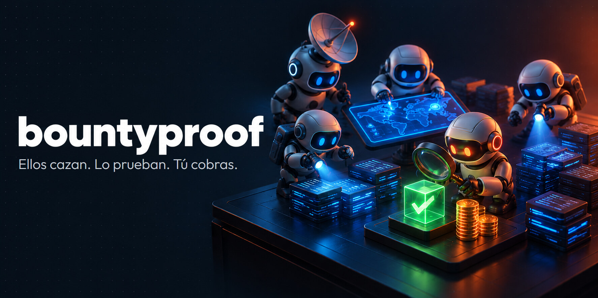
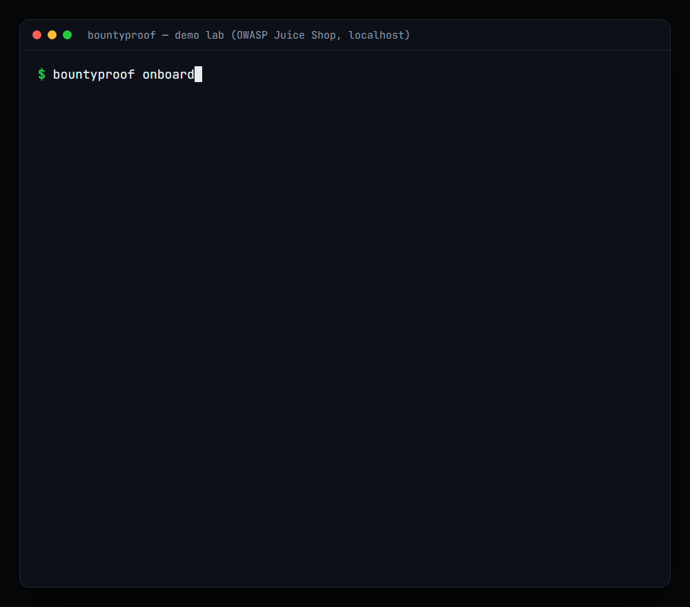
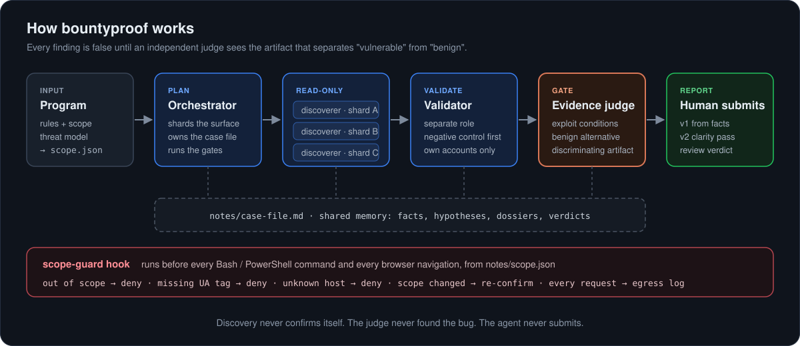

<p align="center">
  
</p>

> Versión en español. La documentación de referencia está en inglés: [README.md](README.md).

**bountyproof** pone a un equipo de agentes de IA a hacer bug bounties por ti. Vigila YesWeHack,
Intigriti y HackerOne buscando programas que encajen contigo, mapea el objetivo, caza bugs, prueba
cada uno, redacta el informe y lo rellena en el formulario de la plataforma, en tu Chrome. Tú solo
haces dos cosas: aprobar el scope y pulsar enviar.

Funciona sobre [Claude Code](https://code.claude.com) como plugin, con una CLI pequeña sin
dependencias.


<p align="center">
  
</p>

## El equipo

| Agente | Qué hace |
|---|---|
| **Radar** | Revisa las plataformas cada hora y te avisa en el móvil cuando sale un programa que encaja contigo o un programa añade scope. |
| **Recon** | Mapea la superficie: hosts, apps, APIs, roles y los flujos que mueven dinero o datos. |
| **Cazadores** | Reparten el objetivo y lo trabajan en paralelo, en solo lectura. Cada pista llega con la prueba que podría tumbarla. |
| **Validador** | Un agente distinto del que encontró la pista. La reproduce con tus cuentas de prueba, empezando por el control negativo. |
| **Juez de evidencias** | Solo deja pasar un hallazgo con lo que necesita un triager: cómo se explota, por qué no es benigno y la petición guardada que lo demuestra. |
| **Redactor** | Escribe el informe solo con hechos verificados. Un juez nuevo lo revisa y después el redactor lo rellena en el formulario de la plataforma, en tu Chrome, y se para antes de enviar. |
| **Tú** | Apruebas el scope. Pulsas enviar. |

<p align="center">
  
</p>

## De cero a tu primer informe

1. **Instala.** En Claude Code:

   ```text
   /plugin marketplace add jorge-asenjo/bountyproof
   /plugin install bountyproof@bountyproof
   ```

   Y la CLI, desde una terminal: `uv tool install git+https://github.com/jorge-asenjo/bountyproof`.
   Para que los agentes te rellenen el formulario del informe, añade la extensión Claude in Chrome
   desde la Chrome Web Store y ejecuta `/chrome` una vez en Claude Code.

2. **Configura.** `bountyproof onboard` tarda unos minutos. Revisa tu máquina (herramientas, Docker,
   móviles conectados por USB), te pregunta en qué plataformas estás y con qué puedes testear, y
   guarda un perfil con el que planifica cada workspace.
3. **Activa las alertas.** Al final te ofrece el Radar: un repo privado de GitHub que vigila las
   plataformas por ti, montado en un paso con la CLI de GitHub, y una alerta de prueba a la app
   gratuita [ntfy](https://ntfy.sh) del móvil.
4. **Pega la alerta.** Cada alerta trae una puntuación de encaje, un primer ángulo y un comando:

   ```text
   [GO 78 | dup:low] HackerOne - Example Corp
   NEW SCOPE: api.example.com | max bounty 5000 USD
   Angle: Enumerate order IDs on the new API; test cross-account access

   bountyproof start "Example Corp" --platform hackerone --url "https://hackerone.com/example-corp"
   ```

   Crea el workspace y arranca los agentes sobre la página del programa: reglas, scope, modelo de
   amenazas.
5. **Aprueba el scope.** Los agentes no pueden tocar un objetivo real hasta que compruebes el scope
   con la página del programa y ejecutes tú `bountyproof scope confirm`. Ellos no pueden ejecutarlo.
6. **Déjalos trabajar.** `/bountyproof:hunt` hace recon, caza, validación, el juez y un informe revisado
   de cada hallazgo que pasa, sin pararse. `bountyproof funnel` muestra cuántas pistas sobreviven a
   cada paso.
7. **Revisa el formulario y pulsa enviar.** El mejor informe te espera rellenado en una pestaña de
   Chrome. Los agentes nunca envían nada.

## Por qué la prueba es lo que da dinero

Las plataformas miden cuántos de tus informes se sostienen. Los inválidos y los "informative" restan
reputación, y la reputación decide a quién invitan a programas privados, donde hay menos competencia.
Además, los programas están saturados de informes de IA que no aguantan la primera reproducción;
curl cerró su bug bounty en enero de 2026 por eso ([BleepingComputer][curl]). Un informe que lleva la
petición y la respuesta que lo demuestran es el que un triager puede aceptar a la primera.

Por eso el juez está delante de cada informe. En las [evals](README.md#evals), el mismo modelo sin
bountyproof dio por bueno un hallazgo convincente cuyas evidencias no existían, tres veces de tres.
Con el juez, ninguna.

## Una pasada real

El GIF de arriba es una pasada real contra el lab de demo (OWASP Juice Shop en `localhost`).
El validador tiró dos pistas que no se reproducían. El juez descartó una más, juntó duplicados en 14
informes y puso prohibiciones de exagerar al resto ("nada de 'volcó todos los usuarios'", "nada de
hablar de dinero real"). El guard de scope bloqueó las pruebas hasta que se confirmó el scope. Aquí
tienes [la pasada completa y el primer informe](docs/examples/juice-shop/).

## Caza con lo que tienes

El onboarding averigua qué puede hacer tu máquina, y lo usan tanto los agentes como el Radar:

| Capacidad | Qué necesita |
|---|---|
| Webs y APIs | Claude Code y Node.js. Los agentes manejan un navegador real (Playwright) y curl. |
| Apps Android | jadx o apktool para leer el código de la app; adb y un móvil por USB para pruebas dinámicas. |
| Apps iOS | Un iPhone y libimobiledevice. |
| Objetivos con código disponible | Docker, para un lab local montado con el código del propio programa. |
| Rellenar el formulario del informe | La extensión Claude in Chrome, con tu sesión iniciada en las plataformas. Activado por defecto; con `bountyproof onboard --no-chrome-fill` lo pegas tú. |

Si tienes un Android en tu perfil, el Radar prioriza los programas con app; sin Docker, puntúa a la
baja los programas white-box. Los agentes nunca planifican trabajo para un dispositivo o una
herramienta que no tienes.

Prueba todo el pipeline sin cuenta de bug bounty: [`lab/`](lab/) lo ejecuta contra OWASP Juice Shop
en `localhost`, con un scope que solo permite el lab.

## Dentro de las reglas

La forma más rápida de perder una cuenta de bug bounty es testear algo fuera de scope. El guard de
scope ([`hooks/scope-guard.mjs`](hooks/scope-guard.mjs)) convierte las reglas del programa en una
comprobación por código que se ejecuta antes de cada comando y de cada navegación del navegador:
bloquea hosts fuera de scope o desconocidos, peticiones sin la cabecera del programa, cualquier
prueba en real antes de que confirmes el scope y cualquier intento del agente de confirmarlo por su
cuenta. Claude in Chrome solo sirve para el formulario de la plataforma: el guard no le deja abrir
el objetivo y te pregunta antes de cualquier clic que el agente describa como enviar. Cada petición
queda registrada en `notes/egress-log.jsonl` con los secretos tapados.

## Logros

¿Has cobrado por un hallazgo en el que te ayudó bountyproof? Añádelo a [WINS.md](WINS.md) con una
pull request. Solo programas públicos o informes divulgados: nunca nombres un programa privado.

## Uso responsable

Solo para pruebas autorizadas: programas en los que estás registrado, dentro de su scope y sus
reglas. Lee [RESPONSIBLE_USE.md](RESPONSIBLE_USE.md) antes de usarlo contra un objetivo real. Los
workspaces de programas privados se quedan en local.

Hecho por [Jorge Asenjo](https://github.com/jorge-asenjo). Licencia MIT.

[curl]: https://bleepingcomputer.com/news/security/curl-ending-bug-bounty-program-after-flood-of-ai-slop-reports/
