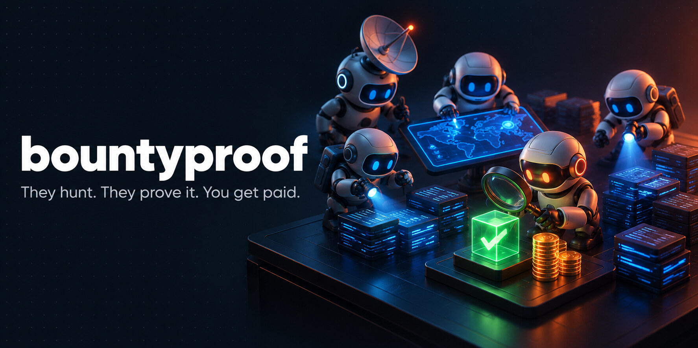
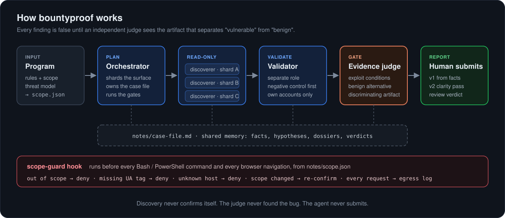

<p align="center">
  
</p>

<p align="center">
  <a href="https://github.com/jorge-asenjo/bountyproof/actions/workflows/ci.yml"></a>
  <a href="LICENSE"></a>
  
  
</p>

<p align="center"><a href="README.es.md">Leer en español</a></p>

**bountyproof** puts a team of AI agents to work on bug bounties. It watches YesWeHack, Intigriti
and HackerOne for programs that fit you, maps the target, hunts for bugs, proves each one and drafts
the report in the platform's format. You do two things: approve the scope and press submit.

It runs on [Claude Code](https://code.claude.com) as a plugin, with a small CLI that has no
dependencies.

## Meet the team

| Agent | What it does |
|---|---|
| **Radar** | Checks the platforms every hour and pings your phone when a program that fits you launches or adds scope. |
| **Recon** | Maps the attack surface: hosts, apps, APIs, roles, and the flows that move money or data. |
| **Hunters** | Split the target into pieces and work them in parallel, read-only. Each lead comes with the test that could prove it wrong. |
| **Validator** | A different agent from the one that found the lead. Reproduces it on your own test accounts, negative control first. |
| **Evidence judge** | Lets a finding through only with what a triager needs: how it's exploited, why it isn't benign, and the saved request that shows it. |
| **Writer** | Drafts the report from verified facts, in the platform's form. A fresh judge reviews it before you submit. |
| **You** | Approve the scope. Press submit. |

<p align="center">
  
</p>

## From zero to your first report

1. **Install.** In Claude Code:

   ```text
   /plugin marketplace add jorge-asenjo/bountyproof
   /plugin install bountyproof@bountyproof
   ```

   And the CLI, from a terminal: `uv tool install git+https://github.com/jorge-asenjo/bountyproof`.

2. **Onboard.** `bountyproof onboard` takes a few minutes. It checks your machine (tools, Docker,
   phones plugged in over USB), asks which platforms you're on and what you can test with, and
   saves a profile that every workspace plans with.
3. **Turn on alerts.** It ends by offering Radar: a private GitHub repo that watches the platforms
   for you, set up in one step with the GitHub CLI, and a test alert to the free
   [ntfy](https://ntfy.sh) app on your phone.
4. **Paste the alert.** Each alert carries a fit score, a first angle and one command:

   ```text
   [GO 78 | dup:low] HackerOne - Example Corp
   NEW SCOPE: api.example.com | max bounty 5000 USD
   Angle: Enumerate order IDs on the new API; test cross-account access

   bountyproof start "Example Corp" --platform hackerone --url "https://hackerone.com/example-corp"
   ```

   It creates the workspace and starts the agents on the program page: rules, scope, threat model.
5. **Approve the scope.** The agents can't touch a live target until you've checked the scope
   against the program page and run `bountyproof scope confirm` yourself. The agents can't run it.
6. **Let them work.** `/bountyproof:hunt` runs recon, hunting, validation, the judge and a reviewed
   report for every finding that passes, without stopping. `bountyproof funnel` shows how many leads
   survived each step.
7. **Read the report and press submit.** The agents never send anything.

## Why proof is where the money is

Platforms track how many of your reports hold up. Invalid and "informative" reports cost
reputation, and reputation decides who gets invited to private programs, where the crowd is thinner.
Programs are also drowning in AI reports that fall apart on the first replay; curl ended its bounty
over them in January 2026 ([BleepingComputer][curl]). A report that carries the request and response
proving it is the kind a triager can accept on the spot.

That's why the judge sits in front of every report. In the [evals](#evals), the same model without
bountyproof passed a convincing finding whose evidence files didn't exist, three times out of three.
With the judge, zero.

## A real run

One pass of the pipeline against the demo lab (OWASP Juice Shop on `localhost`):

```text
  hypotheses proposed    22  ##############################
  validated              17  #######################
  passed the judge       16  ######################
```

The validator threw out two leads that didn't reproduce. The judge discarded one more, merged
duplicates into 14 reports and attached overclaim bans to the rest ("no 'dumped all users'", "no
real-money framing"). The scope guard blocked testing until the scope was confirmed. Read the
[full run and the first report](docs/examples/juice-shop/).

## Hunt with what you have

Onboarding works out what your machine can take on, and both the agents and Radar use it:

| Capability | What it needs |
|---|---|
| Web apps and APIs | Claude Code, Node.js. The agents drive a real browser (Playwright) and curl. |
| Android apps | jadx or apktool to read the app's code; adb and a phone over USB for dynamic tests. |
| iOS apps | An iPhone and libimobiledevice. |
| Source-available targets | Docker, for a local lab built from the program's own code. |

With an Android phone in your profile, Radar favours programs with apps; without Docker, it scores
white-box programs down. The agents never plan work for a device or tool you don't have.

Try the whole pipeline without a bounty account: [`lab/`](lab/) runs it against OWASP Juice Shop on
`localhost`, with a scope file that only allows the lab.

## Stays inside the rules

The fastest way to lose a bounty account is testing something out of scope. The scope guard
([`hooks/scope-guard.mjs`](hooks/scope-guard.mjs)) turns the program's rules into a code-level check
that runs before every shell command and every browser navigation:

| Situation | Result |
|---|---|
| Host out of scope, or unlisted under a domain the program fences off | **deny** |
| In-scope request without the program's UA tag or required headers | **deny** |
| Host that isn't in the scope file at all | **deny** |
| `Host:` header pointing at an out-of-scope vhost | **deny** |
| Scope not confirmed by you, or edited since you confirmed it | **deny** |
| The agent trying to confirm the scope itself | **deny** |
| State-changing request, when `confirmStateChanging` is on | **ask** |

Every checked request goes to `notes/egress-log.jsonl`, with secrets redacted. Check a URL without
sending anything:

```text
$ bountyproof scope check https://admin.acme.example/
DENY  https://admin.acme.example/
  [scope-guard] admin.acme.example is OUT OF SCOPE (notes/scope.json outOfScope). Do not send requests there.
```

The hook sees command text, not what a script does at runtime, so the workspace rules still forbid
routing around it. It fails open on internal errors so a bug can't brick a session.

<details>
<summary><b>All phases and commands</b></summary>

| Phase | Command | Who | Output |
|---|---|---|---|
| Onboard | `bountyproof onboard` / `/bountyproof:onboard` | you + CLI | hunter profile, Radar |
| All of 1-4c | `/bountyproof:hunt` | orchestrator | stops only to confirm the scope and at submit |
| 0 Setup | `/bountyproof:setup` | orchestrator | program rules, threat model, trust map, `scope.json` |
| 1 Recon | `/bountyproof:recon` | read-only subagents | attack surface map |
| 2 Discovery | `/bountyproof:discover` | `discoverer` × shard | leads with dossiers |
| 3 Validation | `/bountyproof:validate` | `validator` | confirmed / rejected / needs_validation |
| 3b Judge | `/bountyproof:judge` | `judge` | PASS / NEEDS_VALIDATION / DISCARD |
| 4a Draft | `/bountyproof:draft` | orchestrator | v1 from verified facts, `[MISSING]` for gaps |
| 4b Clarity | `/bountyproof:clarity` | orchestrator | concise first-person v2, same facts |
| 4c Review | `/bountyproof:review` | fresh `judge` | READY / NEEDS FIXES / DO NOT SUBMIT |
| 5 Calibrate | `/bountyproof:calibrate` | orchestrator | lessons from the real triage outcome |

Each workspace is a folder with its own `CLAUDE.md` (black-box live target, or white-box source +
Docker lab), the phase prompts, your hunter profile and `notes/case-file.md`: the shared memory where
every lead carries a dossier with its benign alternative and a falsifiable test. Agents read and
write the case file, not the chat transcript. Design notes and sources:
[`reference/agent-architecture.md`](reference/agent-architecture.md).

CLI: `onboard`, `radar init`, `new`, `start`, `scope check | confirm | hash`, `funnel`, `doctor`.
Requirements: Claude Code, Node.js 18+, Python 3.10+, git; Docker for white-box labs and the demo
lab. `bountyproof doctor` checks them.

</details>

## Evals

[`evals/`](evals/) holds a seed benchmark for the evidence judge, run with Claude Code's native
`claude plugin eval`. Each case seeds a fictional engagement and asks for a verdict on one finding;
the runner repeats it with and without the plugin, so the difference is what bountyproof adds over
the same model on its own.

First results (Claude Code 2.1.310, `--model opus`, 3 runs per arm, 2026-10-26):

| Case | Expected | With plugin | Without | Δ |
|---|---|---|---|---|
| Cited evidence files don't exist in the workspace | NEEDS_VALIDATION | 1.00 | 0.00 | **+1.00** |
| Properly proven cross-account read, artifacts saved | PASS | 1.00 | 1.00 | 0.00 |
| Reachability only (200 status, no foreign data) | not PASS | 1.00 | 1.00 | 0.00 |
| Data the role already sees in the UI | not PASS | 1.00 | 1.00 | 0.00 |
| Solid finding on an asset excluded by design | not PASS | 1.00 | 1.00 | 0.00 |
| Needs a trusted insider (staff console) | not PASS | 1.00 | 1.00 | 0.00 |
| Plausible race, no artifact captured | NEEDS_VALIDATION | 1.00 | 1.00 | 0.00 |

A strong model already rejects the classic weak-report patterns when they're spelled out. Where the
judge made the difference was checking that the evidence a dossier cites actually exists. Seven cases
is a seed, not a benchmark; harder cases and smaller models are next.

```bash
claude plugin eval . --scaffold --trust-plugin
```

## Wins

Got paid on a finding bountyproof helped with? Add it to [WINS.md](WINS.md) with a pull request.
Public programs or disclosed reports only: never name a private program.

## Responsible use

bountyproof is for authorized testing only: programs you are registered on, inside their published
scope and rules. Read [RESPONSIBLE_USE.md](RESPONSIBLE_USE.md) before using it on a live target.
Private-program workspaces stay local; never push them to a public remote.

## Roadmap

- **Walkthrough video:** from onboarding to a submitted report.
- **More evals:** judge cases built from publicly disclosed reports, pipeline cases against the lab,
  results across models.
- **Observability:** cost and tokens per phase, an HTML evidence viewer.
- **Scope guard as a standalone plugin** for any Claude Code security workflow.

## Credits

Ideas this builds on: separating discovery from validation and judging on evidence (Google Project
Zero's Naptime / Big Sleep, Cloudflare's security-audit-skill), human scope confirmation that resets
when the scope changes (ZeroProtocol). The [YesWeHack claude-kit](https://github.com/yeswehack/claude-kit)
plugin is a good companion for report writing on YesWeHack.

Built by [Jorge Asenjo](https://github.com/jorge-asenjo). MIT licensed.

[curl]: https://bleepingcomputer.com/news/security/curl-ending-bug-bounty-program-after-flood-of-ai-slop-reports/
