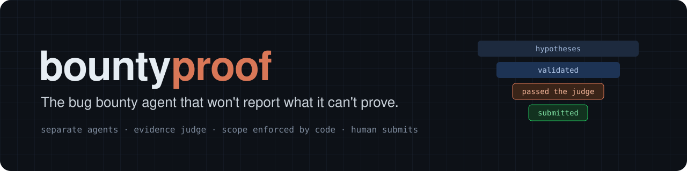

<p align="center">
  
</p>

<p align="center">
  <a href="https://github.com/jorge-asenjo/bountyproof/actions/workflows/ci.yml"></a>
  <a href="LICENSE"></a>
  
  
</p>

<p align="center"><a href="README.es.md">Leer en español</a></p>

**bountyproof** is an agent harness for bug bounty work, built on Claude Code. It splits an
engagement into phases run by separate agents, keeps every request inside the program's scope with
a hook, and puts an independent evidence judge in front of every report. A finding is false until
the judge sees the artifact that separates "vulnerable" from "benign".

## Why

Bug bounty programs are drowning in AI-generated reports that fall apart on the first replay.
curl ended its paid bug bounty in January 2026 after a flood of them ([BleepingComputer][curl]).
Most AI hunting tools optimize for finding more. bountyproof optimizes for being believed:

- **Discovery and validation are different agents.** The agent that proposes a bug never confirms it.
- **An evidence judge gates every report.** Exploitation conditions, the best benign explanation,
  and the discriminating artifact, or no report.
- **Scope is enforced by code, not by prompt.** A `PreToolUse` hook blocks out-of-scope hosts,
  missing program headers and unknown hosts, and logs every request.
- **The human presses submit.** The agent drafts and reviews; it never sends a report.

## Quickstart

Inside Claude Code:

```text
/plugin marketplace add jorge-asenjo/bountyproof
/plugin install bountyproof@bountyproof
/bountyproof:new "Acme Corp" --platform hackerone --mode blackbox
```

Then open Claude Code in the new workspace and run `/bountyproof:setup <program URL>`.

Prefer a terminal? The CLI has no dependencies:

```bash
uvx --from git+https://github.com/jorge-asenjo/bountyproof bountyproof new "Acme Corp" --platform ywh
```

Requirements: [Claude Code](https://code.claude.com), Node.js 18+ (runs the scope guard), Python
3.10+, git. Docker for white-box labs and the demo lab. Run `bountyproof doctor` to check.

### Try it without a bounty account

[`lab/`](lab/) runs the whole pipeline against OWASP Juice Shop on `localhost`, with a scope file
that only allows the lab. Nothing leaves your machine.

## How it works

<p align="center">
  
</p>

| Phase | Command | Who | Output |
|---|---|---|---|
| 0 Setup | `/bountyproof:setup` | orchestrator | program rules, threat model, trust map, `scope.json` |
| 1 Recon | `/bountyproof:recon` | read-only subagents | attack surface map |
| 2 Discovery | `/bountyproof:discover` | `discoverer` × shard | candidate hypotheses with dossiers |
| 3 Validation | `/bountyproof:validate` | `validator` | confirmed / rejected / needs_validation |
| 3b Judge | `/bountyproof:judge` | `judge` | PASS / NEEDS_VALIDATION / DISCARD |
| 4a Draft | `/bountyproof:draft` | orchestrator | v1 from verified facts, `[MISSING]` for gaps |
| 4b Clarity | `/bountyproof:clarity` | orchestrator | concise first-person v2, same facts |
| 4c Review | `/bountyproof:review` | fresh `judge` | READY / NEEDS FIXES / DO NOT SUBMIT |
| 5 Calibrate | `/bountyproof:calibrate` | orchestrator | lessons from the real triage outcome |

Each workspace is a folder with its own `CLAUDE.md` (black-box live target, or white-box source +
Docker lab), the phase prompts, and `notes/case-file.md`: the shared memory where every hypothesis
carries a dossier with its benign alternative and a falsifiable test. Agents read and write the
case file, not the chat transcript.

Design notes and sources: [`reference/agent-architecture.md`](reference/agent-architecture.md).

## The evidence funnel

`bountyproof funnel` shows how many hypotheses survived each gate. Example output:

```text
Evidence funnel - acme-corp-hackerone

  hypotheses proposed    14  ##############################
  validated               4  #########
  passed the judge        2  ####
  submitted               1  ##
  accepted                1  ##

  dropped: DISCARDED 2, needs_validation 2, rejected 6
```

A narrow funnel is the point. Most hypotheses should die before they cost a triager any time.

## Guardrails

The scope guard ([`hooks/scope-guard.mjs`](hooks/scope-guard.mjs)) runs before every Bash and
PowerShell command and every browser navigation, using the workspace's `notes/scope.json`:

| Situation | Result |
|---|---|
| Host listed as out of scope, or unlisted under a `denyUnlisted` domain | **deny** |
| In-scope request without the program's UA tag or required headers | **deny** |
| Host that isn't in the scope file at all | **deny** |
| `Host:` header pointing at an out-of-scope vhost | **deny** |
| State-changing request, when `confirmStateChanging` is on | **ask** |
| Scope edited since the last human confirmation, when `requireConfirm` is on | **deny** |

Every checked request is appended to `notes/egress-log.jsonl` with secrets redacted. Test your scope
file without sending anything:

```text
$ bountyproof scope check https://admin.acme.example/
DENY  https://admin.acme.example/
  [scope-guard] admin.acme.example is OUT OF SCOPE (notes/scope.json outOfScope). Do not send requests there.
```

The hook sees command text, not what a script does at runtime, so the workspace rules still forbid
routing around it. It fails open on internal errors so a bug can't brick a session.

## Evals

[`evals/`](evals/) holds a seed benchmark for the evidence judge, run with Claude Code's native
`claude plugin eval`. Five cases are the classic ways reports get closed for nothing (reachability
without impact, data the role can already see, an excluded asset, an insider precondition, a missing
artifact) and one is a properly proven finding that must pass. The runner repeats every case with and
without the plugin, so the difference is what the judge adds.

```bash
claude plugin eval . --scaffold --trust-plugin
```

## Radar

[`radar/`](radar/) watches YesWeHack, Intigriti and HackerOne for new programs and scope additions,
scores each one against a fit rubric you edit, and sends an alert with the command that sets up the
workspace. It runs as GitHub Actions in your own private repo.

## Responsible use

bountyproof is for authorized testing only: programs you are registered on, inside their published
scope and rules. Read [RESPONSIBLE_USE.md](RESPONSIBLE_USE.md) before using it on a live target.
Private-program workspaces stay local; never push them to a public remote.

## Roadmap

- **More evals.** Judge cases built from publicly disclosed reports (valid and invalid), pipeline
  cases against the lab target, and results across models.
- **Observability.** Case file with a JSON schema, cost and tokens per phase, an HTML evidence viewer.
- **Scope guard as a standalone plugin** for any Claude Code security workflow.

## Credits

Ideas this harness builds on: separating discovery from validation and judging on evidence
(Google Project Zero's Naptime / Big Sleep, Cloudflare's security-audit-skill), human scope
confirmation that resets when the scope changes (ZeroProtocol). The
[YesWeHack claude-kit](https://github.com/yeswehack/claude-kit) plugin is a good companion for
report writing on YesWeHack.

Built by [Jorge Asenjo](https://github.com/jorge-asenjo). MIT licensed.

[curl]: https://bleepingcomputer.com/news/security/curl-ending-bug-bounty-program-after-flood-of-ai-slop-reports/
