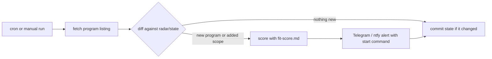

# Radar

Radar watches bug bounty platforms for **new programs** and **scope added to existing programs**,
scores each one against your own fit rubric with an LLM, and sends you an alert with a one-line
command that scaffolds a bountyproof workspace and starts Phase 0.

It's a set of GitHub Actions workflows (bash, curl and jq, nothing to install) that you run in your
own **private** repository with your own credentials.



Being first on a freshly added asset is the most reliable way to avoid duplicates, which is why scope
additions get their own detection and weigh more in the default rubric than brand-new programs.

## What each workflow detects

| Workflow | Auth | New programs | Scope additions |
|---|---|---|---|
| `radar-yeswehack.yml` | none (public listing) | every run | every run, from the listing's scope counter; details are fetched only for programs whose count changed |
| `radar-intigriti.yml` | `INTIGRITI_TOKEN` | every run | once per UTC day, full pass over program details; assets tiered "out of scope" are ignored |
| `radar-hackerone.yml` | `H1_USERNAME` + `H1_TOKEN` | every run | once per UTC day, bounty programs only (set `RADAR_H1_SCOPE_ALL=true` to include VDPs); compares assets eligible for submission |

Default schedule: hourly on weekdays, 06:00-21:00 UTC, staggered (:07, :27, :47). The first run
of each UTC day does the Intigriti and HackerOne scope pass. Every workflow also has a manual
**Run workflow** button with `baseline`, `test_alert` and (Intigriti, HackerOne) `scope_pass` inputs.

## Setup

1. **Create a private repository.** Don't use the Fork button: GitHub forks of a public repository
   stay public, and your state files shouldn't be (see [Privacy](#privacy)).
2. **Copy Radar into it.** The workflows expect this layout:

   ```bash
   # inside your new private repo
   mkdir -p .github/workflows radar/state
   cp /path/to/bountyproof/radar/workflows/radar-*.yml .github/workflows/   # or only the platforms you use
   cp /path/to/bountyproof/radar/fit-score.md radar/
   touch radar/state/.gitkeep
   git add . && git commit -m "Add Radar" && git push
   ```

3. **Edit `radar/fit-score.md`.** Replace the example values under *Your hunter profile* with your
   own strengths, preferred surfaces and constraints. It's the single biggest lever on alert quality.
4. **Add repository secrets** (Settings > Secrets and variables > Actions > Secrets), using the
   [secrets table](#secrets) below. With the GitHub CLI, `gh secret set NAME` prompts for the value,
   so it never lands in your shell history.
5. **Optionally set repository variables** (same page, Variables tab), using the
   [variables table](#variables) below.
6. **Check Actions is enabled** (Settings > Actions > General). The workflows request
   `contents: write` themselves so they can commit state. If your organization forces the
   `GITHUB_TOKEN` to read-only, allow read and write permissions there.
7. **Run each workflow once** (Actions > *Radar: ...* > Run workflow). The first run, manual or
   scheduled, is a **silent baseline**: it records every current program in `radar/state/` and sends
   nothing. Then run it again with **test_alert** ticked to check the API key and your notification
   channels end to end. After that the schedule takes over.

## Secrets

Every secret is optional unless the platform's workflow needs it. Each channel is used only when its
secrets are set, and secrets are exposed only to the step that needs them.

| Secret | Used by | Notes |
|---|---|---|
| `INTIGRITI_TOKEN` | `radar-intigriti.yml` (required) | Researcher API token from your Intigriti account settings. Sent as a bearer token. |
| `H1_USERNAME` | `radar-hackerone.yml` (required) | Your HackerOne username (HTTP basic auth). |
| `H1_TOKEN` | `radar-hackerone.yml` (required) | API token from hackerone.com > Settings > API token. Shown only once. |
| `ANTHROPIC_API_KEY` | all | Enables scoring. Without it, nothing is scored and every item is alerted as FYI. |
| `TELEGRAM_BOT_TOKEN` | all | From @BotFather. Set together with `TELEGRAM_CHAT_ID`. |
| `TELEGRAM_CHAT_ID` | all | Message your bot once, then read `message.chat.id` from `https://api.telegram.org/bot<token>/getUpdates`. |
| `NTFY_TOPIC` | all | ntfy topic to publish to. On ntfy.sh, anyone who knows the name can read it, so use a long random one (`openssl rand -hex 16`). |
| `NTFY_TOKEN` | all | Optional access token for a protected topic or a self-hosted server. |

## Variables

| Variable | Default | Effect |
|---|---|---|
| `RADAR_MODEL` | `claude-haiku-5-5` | Model used for scoring. |
| `RADAR_MIN_VERDICT` | `FYI` | Lowest verdict that gets a notification: `GO`, `FYI` or `SKIP`. Every item still appears in the run summary. |
| `RADAR_MAX_ALERTS` | `15` | Cap on individual messages per run. The rest go out as one summary message linking to the run. |
| `NTFY_SERVER` | `https://ntfy.sh` | Base URL of a self-hosted ntfy server. |
| `RADAR_H1_SCOPE_ALL` | `false` | `true` also diffs the scope of HackerOne programs that don't pay bounties. |

## What an alert looks like

```text
[GO 78 | dup:low] YesWeHack - Example Corp
NEW SCOPE: https://api.example.com | max bounty 5000 EUR
Angle: Enumerate order IDs on the new API; test cross-account access
Why: fresh API asset on a paying program; few reports
https://yeswehack.com/programs/example-corp

bountyproof start "Example Corp" --platform ywh --url "https://yeswehack.com/programs/example-corp"
```

GO alerts are loud: an audible Telegram message and ntfy priority 4 (high). FYI and SKIP go out as
silent Telegram messages and ntfy priority 3 and 2. Characters that are special inside double quotes
(`"`, `` ` ``, `$`, `\`) are stripped from the command, so it's always safe to paste into bash, zsh or
PowerShell.

## How scoring works

- Scoring runs **only on items detected in this run**. Each batch of up to 20 items is one request to
  the Anthropic Messages API, with `radar/fit-score.md` as the system prompt and the items as JSON
  lines.
- The response is constrained with structured outputs to `{verdict: GO|FYI|SKIP, score: 0-100,
  angle, dup_risk, reasons}` per item, so it parses without any cleanup.
- The rubric weighs scope additions over new programs, bounty over VDP, report density as duplicate
  risk (a "new" program that already has reports the first time Radar sees it means a crowd has been
  through it), freshness with a 21-day half-life, whether you can actually get accounts, and your own
  demonstrated edge. Verdicts: GO 65 and up, FYI 35-64, SKIP below that. All of it lives in
  `fit-score.md`, so you can change it.
- Scoring never drops an alert. If the key is missing, the API errors, the model refuses or the output
  is unusable, the affected items go out as FYI marked `unscored`, and the run log says why.

## Cost

- **LLM:** most runs are a cheap fetch and diff that find nothing, so they make no API call at all.
  When something new shows up, one Haiku request per 20 items costs a fraction of a cent at the time
  of writing. The *Score new items* step logs token usage for each batch.
- **GitHub Actions:** private repositories use your plan's Actions minutes (GitHub Free includes
  2,000 a month at the time of writing). On the default schedule, all three workflows together use
  roughly 1,200 minutes a month, because every run is billed as at least one minute. Thin out the
  cron lines if you need to.

## Privacy

- **Run Radar in a private repository.** The state files are committed to the repo.
  `yeswehack.json` only holds public programs, but the Intigriti and HackerOne researcher APIs return
  every program your account can see, **including private programs you were invited to**, so
  `intigriti.json` and `hackerone.json` list those programs and their scope.
- Alerts pass through Telegram or ntfy, and scoring sends item details (names, scope, reward signals)
  to the Anthropic API. If a private program's terms forbid sharing its details with third parties or
  feeding them to AI tools, don't enable scoring or notifications for that platform.
- Workflows never print secrets, and each secret is exposed only to the step that uses it.

## Limitations

- **Private invitations never show up in public listings, so Radar can't see them.** YesWeHack's
  listing is public-only, and Intigriti and HackerOne show a private program only once you've joined
  it. Invitations arrive through the platform inbox and email, so keep an eye on those.
- Intigriti and HackerOne scope additions are detected at most once a day. YesWeHack relies on the
  listing's scope counter, so an asset swap that leaves the count unchanged goes unnoticed.
- The platform APIs can change. On an unexpected response, the fetch step fails loudly and leaves the
  state untouched rather than recording garbage.
- GitHub's cron is best-effort, and runs can start late at busy times.
- Radar only reads platform program listings. It never touches a target.

## Customizing and troubleshooting

- **Schedule:** edit the `cron` line in each workflow (times are UTC).
- **Different folder:** change `RADAR_DIR` and `RADAR_STATE` in the workflow's `env` block.
- **Re-baseline:** run the workflow with `baseline` ticked, or delete the state file.
- **No alerts after setup:** expected, because the first run is a silent baseline. Use `test_alert` to
  confirm the pipeline works.
- **Listing fails with 401/403:** the platform token expired or was revoked. Update the secret.
- **"Could not push radar state":** the workflow lacks write permission (see setup step 6).
- **Every alert says `unscored`:** check `ANTHROPIC_API_KEY` and `RADAR_MODEL`. The *Score new items*
  step log shows the API's error message.
